<div align="center">

</div>

## 🌙 Hi, I'm Vaidehi

**Second-year B.Tech student in Artificial Intelligence & Data Science** at SVKM's Dwarkadas J. Sanghvi College of Engineering (**DJSCE**), Mumbai — with hands-on experience in **machine learning, data analysis, and web development**.

I like projects where the challenge is real: predicting layoff risk from hard numbers, making an app usable for people with colour-vision deficiency, and building interfaces that stay sharp on every screen size.

📍 Virar, Maharashtra · ✉️ [vaidehinar42@gmail.com](mailto:vaidehinar42@gmail.com) · 💼 [LinkedIn — Vaidehi Narvekar](https://www.linkedin.com/in/vaidehi-narvekar-62a452387/)

---

## 🏆 Hackathons & Achievements

| Event | Result |
| --- | --- |
| **CodeSlayer 2K26** — DevSphereIndia, national level @ NIT Delhi | Selected in the PPT round · *Vridhi.ai* — explainable AI credit scoring for MSMEs with no CIBIL history |
| **HackConquest** — TCET Mumbai | Selected in the PPT round for the further stage · *Vridhi.ai* (MSME credit risk analytics) |
| **Smart India Hackathon 2026 — Internal Round**, DJSCE | Selected in the PPT round · *Swasthya-Setu* (NAMASTE / ICD-11) |
| **Binary Battle ML: Bank Customer Churn Challenge** — Kaggle | **Leaderboard rank 24** · best score **0.88675** · LightGBM + XGBoost + CatBoost ensemble on 165K customer records |
| **ZeroCode** — Techfest, IIT Bombay | Participated in the prompt-engineering competition |
| **MHT-CET 2025** | **97.9 percentile** (state rank 7316) |
| **JEE Main 2025** | 83.1 percentile · General rank 249351 |

---

## 🚀 Projects

### 🏦 Featured · ML / Data

- **Vridhi.ai — Explainable AI Credit-Risk Analytics for MSMEs** · <code>React 18</code> <code>Vite</code> <code>Tailwind</code> <code>Recharts</code> <code>FastAPI</code> · 💾 [Repo](https://github.com/Vaidehi42/Vridhi-ai) · 🚀 [Live demo](https://vridhiai-dyj2nqik.manus.space/)
  Credit-risk analytics platform for Indian MSMEs with no CIBIL history, designed to keep every risk factor explainable. Selected in the PPT rounds of **CodeSlayer 2K26** (national-level, NIT Delhi) and **HackConquest** (TCET Mumbai).

### 📊 Machine Learning & Data

- **Job Layoff Risk Prediction** · <code>Python</code> <code>Pandas</code> <code>NumPy</code>
  Trained and compared **Logistic Regression, Decision Tree, and Random Forest** on the *AI Impact on Jobs and Layoff Risk* dataset (Kaggle) to predict job automation / layoff risk.
- **TikTok Video Dataset — Exploratory Data Analysis** · <code>Python</code> <code>Pandas</code>
  Cleaned and de-duplicated a raw video dataset, engineered **Total Engagement** and **Engagement Rate** features from view/like/share/comment counts, and exported the enriched dataset for further analysis.
- **AdaptiveVision — Colour Vision Deficiency Correction** · <code>Research</code> <code>Group Project (IPD)</code>
  Researched real-time colour-correction technology — colour spaces, **daltonization**, **YOLO** — and reviewed 2022–2026 papers, documenting findings, limitations, and open research gaps.

### 🕸 Web Development

- **OnlyPipe — Sign-Up Page UI** · <code>HTML</code> <code>CSS</code>
  Responsive, dark-themed sign-up page with a step-progress tracker, social login options, and form validation.
- **Zerodha Landing Page (Clone)** · <code>HTML</code> <code>CSS</code>
  Rebuilt Zerodha's landing page — navbar, hero, feature highlights, CTA sections — to sharpen responsive-layout fundamentals.

---

## 🧠 Skills

```text
Languages   : Python · Java · C · JavaScript · HTML · CSS
Data / ML   : Pandas · NumPy · Scikit-learn · LightGBM · XGBoost · CatBoost · Matplotlib · Seaborn
Web         : React · HTML · CSS · JavaScript
Tools       : Git/GitHub · Excel
```

<details>
<summary>🎓 Education</summary>

- **B.Tech, Artificial Intelligence & Data Science** — SVKM's DJSCE · 2025 – 2029 (Expected)
- **Class 12** — S.R.T. Vidyamandir High School & Junior College · 81% · 2024 – 2025

</details>

---

## 🔥 GitHub Heatmap

*Live contribution data — burgundy-tinted to match this profile.*


## 📈 GitHub Stats

*Rendered by [github-readme-stats](https://github.com/anuraghazra/github-readme-stats) and [streak stats](https://github.com/DenverCoder1/github-readme-streak-stats) from my real activity — no numbers below are invented.*

<div align="center">


</div>

---

<div align="center">

</div>
